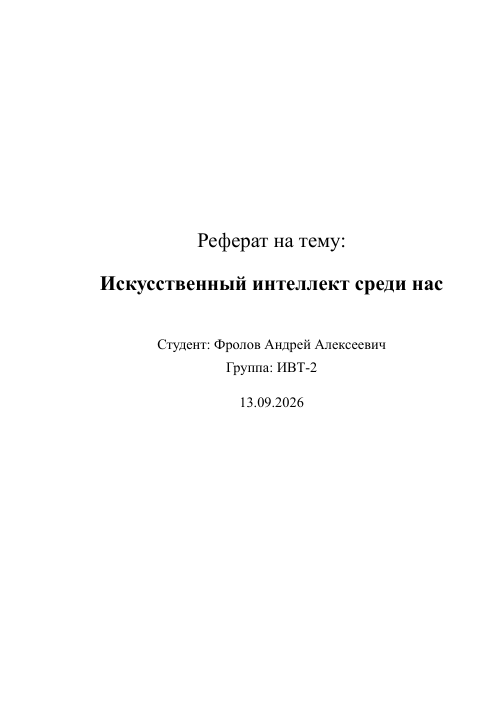
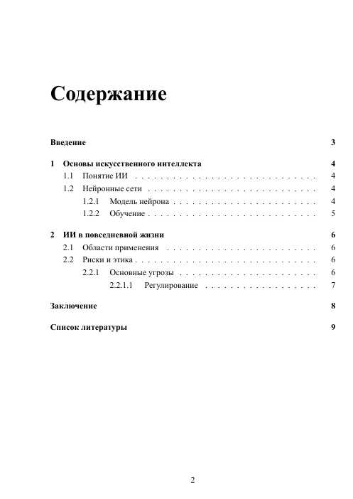
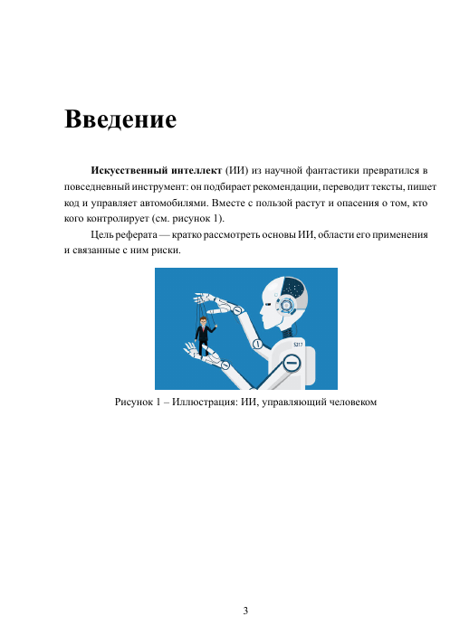
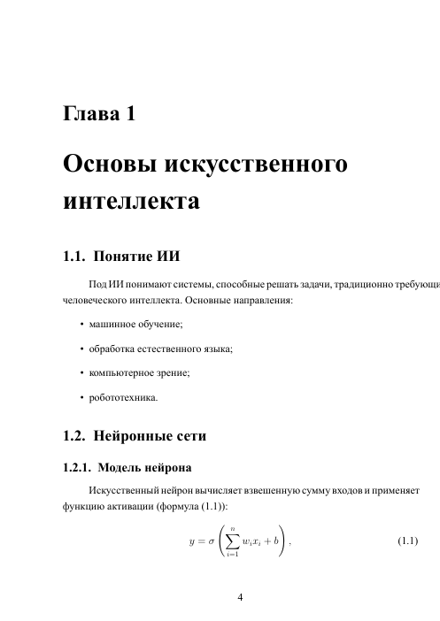
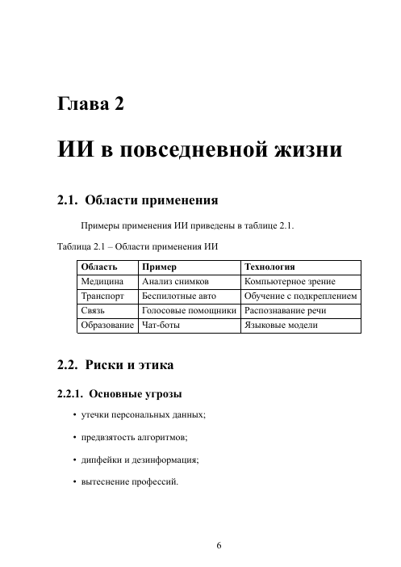
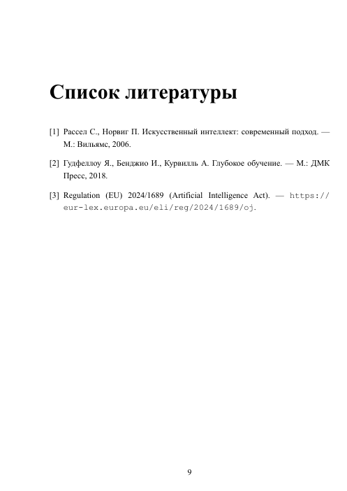

# Лабораторная работа 1. Реферат в LuaLaTeX

Реферат "Искусственный интеллект среди нас", сверстанный в LuaLaTeX. Оформление: шрифт Times New Roman 14 pt, полуторный интервал, поля 30/10/20/20 мм, абзацный отступ 1,25 см. В PDF 9 страниц.

## Файлы

| Файл | Что это |
|---|---|
| `laboratory-work-01.tex` | исходник |
| `laboratory-work-01.pdf` | готовый реферат |
| `image.jpg` | иллюстрация для введения |

Остальное (`.aux`, `.log`, `.toc` и подобные) - служебные файлы сборки.

## Как выглядит

| | | |
|---|---|---|
|  |  |  |
|  |  |  |

## Что использовано

| Элемент | Как сделано |
|---|---|
| Класс документа | `extreport` с размером 14 pt |
| Шрифты | `fontspec`: Times New Roman для текста, Courier New для кода |
| Русский язык | `polyglossia`, заголовки "Содержание" и "Список литературы" переопределены |
| Поля и интервал | `geometry`, `setspace`, `indentfirst` |
| Структура | главы, разделы и подразделы до уровня `subsubsection`, все попадают в содержание |
| Формулы | `amsmath`, три нумерованные формулы со ссылками через `\eqref` |
| Рисунок | `graphicx` и `float`, подпись в формате "Рисунок 1 - ..." |
| Таблица | `tabular` с подписью сверху слева |
| Списки | маркированные и нумерованный |
| Ссылки | `hyperref`: перекрестные ссылки на рисунок, таблицу и формулы, внешняя ссылка |
| Литература | `thebibliography`, три источника, ссылки через `\cite` |

## Сборка

```bash
lualatex laboratory-work-01.tex
```

Запустить нужно дважды, чтобы собрались содержание и перекрестные ссылки. В системе должны стоять шрифты Times New Roman и Courier New.
