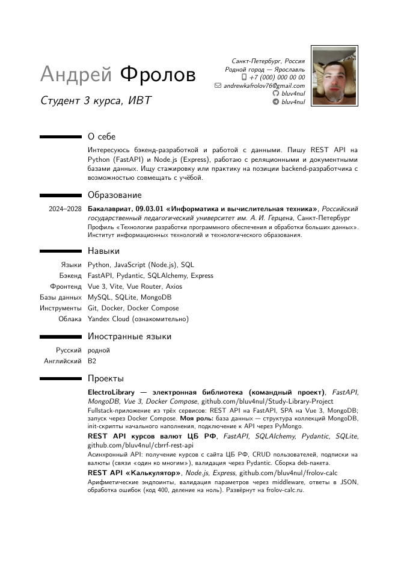

# Лабораторная работа 2. Резюме в LaTeX

Мое резюме на одну страницу, сверстанное в LuaLaTeX на классе `moderncv`.

## Файлы

| Файл | Что это |
|---|---|
| `Frolov-AA-CV.tex` | исходник |
| `Фролов А.А. ИВТ-2, 3ий курс, лр-CV.pdf` | готовое резюме |
| `avatar.jpg` | фотография для шапки |

Остальное (`.aux`, `.log`, `.out`) - служебные файлы сборки.

## Как выглядит



## Что использовано

| Элемент | Как сделано |
|---|---|
| Класс документа | `moderncv`, стиль `classic`, цвет `blue` |
| Шрифты | `fontspec`: CMU Sans Serif и CMU Typewriter Text |
| Русский язык | `polyglossia` |
| Шапка | `\name`, `\title`, `\address`, `\phone`, `\email`, `\social`, `\photo` |
| Разделы | "О себе", "Образование", "Навыки", "Иностранные языки", "Проекты" |
| Записи | `\cventry` для образования и проектов, `\cvitem` для навыков, `\cvitemwithcomment` для языков |
| Ссылки | `\href` на репозитории проектов |

В разделе "Проекты" три работы: командная электронная библиотека ElectroLibrary, REST API курсов валют ЦБ РФ и REST API "Калькулятор".

## Сборка

```bash
lualatex Frolov-AA-CV.tex
```

В исходнике вместо номера телефона стоят нули.
