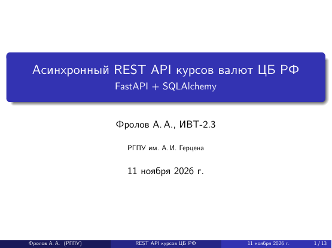
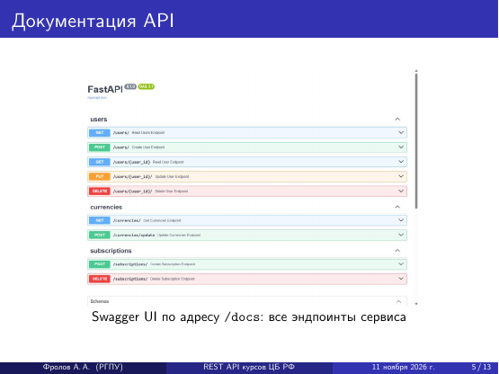
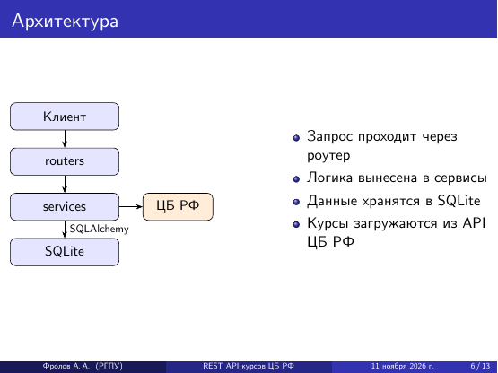
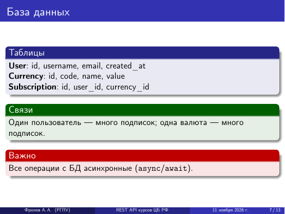
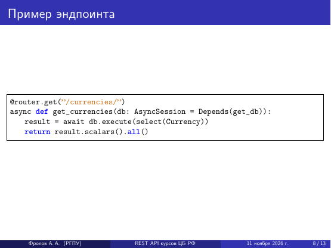
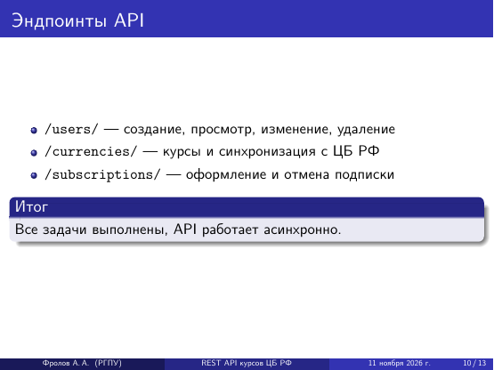
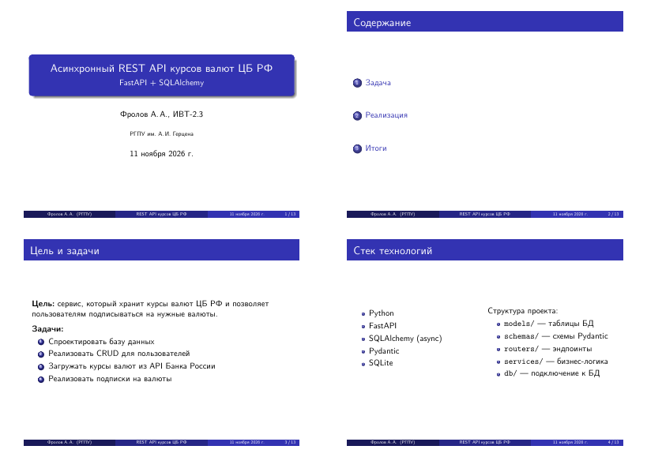
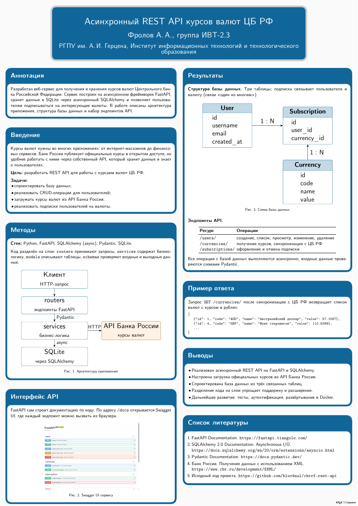

# Лабораторная работа 3. Презентация и постер в LaTeX

Две части: презентация на Beamer и научный постер на tikzposter. Тема у обеих одна - мой проект [cbrrf-rest-api](https://github.com/bluv4nul/cbrrf-rest-api), асинхронный REST API курсов валют ЦБ РФ на FastAPI и SQLAlchemy.

Все собирается LuaLaTeX, шрифты подключены через `fontspec`, русский язык через `polyglossia`.

## Файлы

| Файл | Что это |
|---|---|
| `presentation.tex`, `presentation.pdf` | презентация, 13 слайдов (18 страниц с наложениями) |
| `presentation-handout.pdf` | раздаточный материал, по 4 слайда на листе A4 |
| `poster.tex`, `poster.pdf` | постер формата A0 |
| `swagger.jpg` | скриншот Swagger UI, вставлен в презентацию и постер |
| `screenshots/` | картинки для этого файла |

Остальное (`.aux`, `.log`, `.nav` и подобные) - служебные файлы сборки.

## Часть 1. Презентация

| | |
|---|---|
|  |  |
|  |  |
|  |  |

Что из задания где использовано:

| Шаг | Элемент | Слайд |
|---|---|---|
| 1 | титульный слайд, `\title`, `\author`, `\date{\today}` | первый |
| 2 | нумерованный и маркированные списки | "Цель и задачи", "Стек технологий" |
| 2 | колонки | "Стек технологий", "Архитектура" |
| 2 | изображение | "Документация API" |
| 3 | блоки `block`, `exampleblock`, `alertblock` | "База данных" |
| 3 | код через `listings` и `verbatim` | "Пример эндпоинта", "Запуск и ссылки" |
| 3 | гиперссылки `\href` | "Запуск и ссылки" |
| 4 | наложения `\item<1->`, `\onslide`, `[<+->]` | "Эндпоинты API", "Выводы" |
| 5 | тема `Madrid` | вся презентация |
| 5 | режим `handout` и слайд только для раздатки | `presentation-handout.pdf` |

Схема на слайде "Архитектура" нарисована в TikZ прямо в исходнике.

Раздатка собирается из того же `presentation.tex`. В режиме `handout` наложения схлопываются, а `pgfpages` ставит по четыре слайда на лист:



## Часть 2. Постер

Постер сделан на `tikzposter`: тема `Simple`, палитра `BlueGrayOrange`, цвета заголовков и блоков переопределены поверх нее.



На постере восемь блоков в двух колонках: аннотация, введение, методы, интерфейс API, результаты, пример ответа, выводы, список литературы. Схемы архитектуры и базы данных нарисованы в TikZ, таблица эндпоинтов сделана через `booktabs`. Пример ответа на постере настоящий: это то, что сервис вернул на `GET /currencies/`.

## Сборка

```bash
lualatex presentation.tex
```

```bash
lualatex poster.tex
```

Презентацию нужно собрать дважды, иначе не появится содержание. Раздатка собирается отдельной командой, исходник при этом менять не надо:

```bash
lualatex -jobname=presentation-handout "\PassOptionsToClass{handout}{beamer}\input{presentation.tex}"
```
