# Лабораторная работа 4. Создание технической документации к игре Alien Invasion

## Цель работы

Написать для игры Alien Invasion два документа, SRS и SDD, в своем Wiki.js и разбить функциональные требования на задачи в Redmine.

Сама игра у меня уже есть: я делал ее на практической работе 1 по компьютерной графике на Python и Pygame. В ней восемь модулей, в каждом по одному классу. Так что требования я писал с оглядкой на готовый код и все числа брал из `settings.py`.

## Окружение

Wiki.js и Redmine работают у меня локально в Docker, оба описаны в одном файле `WikiAlien/compose.yaml`.

| Сервис | Образ | Адрес |
|---|---|---|
| Wiki.js | `ghcr.io/requarks/wiki:2` | `http://127.0.0.1:8080` |
| База Wiki.js | `postgres:17-alpine` | внутри сети Docker |
| Redmine 6.1.6 | `redmine:6` | `http://127.0.0.1:3000` |
| База Redmine | `postgres:17-alpine` | внутри сети Docker |

Все поднимается из папки `WikiAlien` одной командой:

```bash
docker compose up -d
```

Wiki.js остался с прошлой работы. На этом ноутбуке Docker был пустой, поэтому базу вики я восстановил из своего дампа `backups/wiki_alien_2026-09-24.dump`. Redmine раньше не ставил, для этой работы добавил его в тот же `compose.yaml` отдельным сервисом с собственной базой. Пароли лежат в `.env`.

## Часть 1. Документация в Wiki.js

В вики четыре страницы: главная, паспорт документации, SRS и SDD. С прошлого раза от SRS и SDD были только каркасы с заглушками в квадратных скобках, сейчас я их заполнил. Тексты страниц в Markdown сохранил в `WikiAlien/docs`, чтобы они лежали в репозитории.

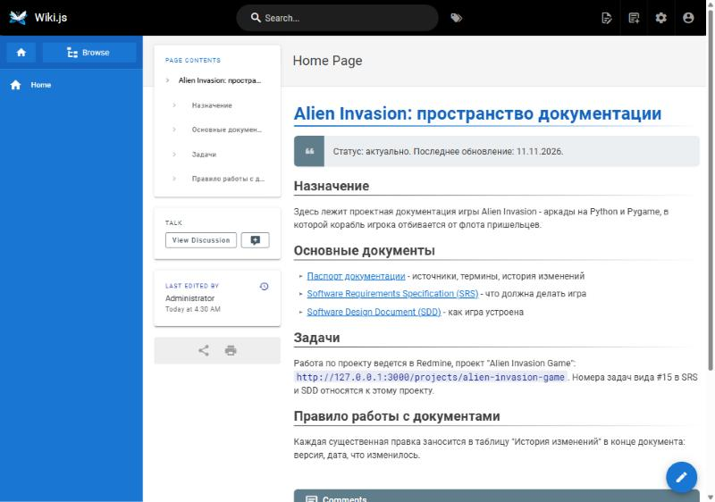

### 1.1. SRS

Страница называется "Software Requirements Specification (SRS) for Alien Invasion" и лежит по пути `/alien-invasion/srs`.

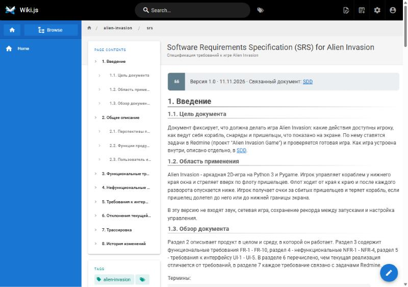

Первые пять разделов взяты из задания, еще три я добавил сам:

| Раздел | Содержание |
|---|---|
| 1. Введение | цель документа, область применения, обзор, термины |
| 2. Общее описание | перспективы продукта, функции, пользователь и ограничения |
| 3. Функциональные требования | FR-1 - FR-10 с приоритетами |
| 4. Нефункциональные требования | NFR-1 - NFR-4 и способ проверки каждого |
| 5. Требования к интерфейсу | UI-1 - UI-5 |
| 6. Отклонения текущей реализации | чем готовая игра отличается от требований |
| 7. Трассировка | какое требование какими задачами Redmine закрывается |
| 8. История изменений | версии документа |

В задании дано шесть примеров функциональных требований. У меня их вышло десять, потому что кнопку Play, уровни, потерю корабля и выход из игры я вынес в отдельные пункты. В формулировках стоят конкретные значения из кода: на экране не больше 6 снарядов, флот при развороте опускается на 12 пикселей, пришелец на первом уровне стоит 50 очков, скорости растут в 1,1 раза за уровень.

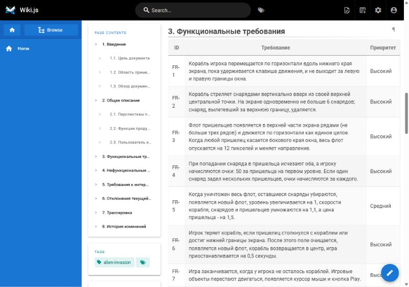

Пока сверял требования с кодом, нашел четыре места, где игра им не соответствует. Записал их в раздел 6 SRS и на каждое завел задачу в Redmine:

| Требование | Что не так | Задача |
|---|---|---|
| FR-8 | число оставшихся кораблей нигде не показывается | #15 |
| UI-4 | счет рисуется в левом верхнем углу, хотя должен быть в правом | #18 |
| FR-7 | отдельного экрана Game Over нет | #16 |
| NFR-1 | частота кадров не ограничена | #17 |

Про счет в левом углу я раньше не знал. В `Scoreboard.show_score()` у меня стоит `self.screen_rect` там, где должен быть `self.score_rect`.

### 1.2. SDD

Страница "Software Design Document (SDD) for Alien Invasion", путь `/alien-invasion/sdd`.

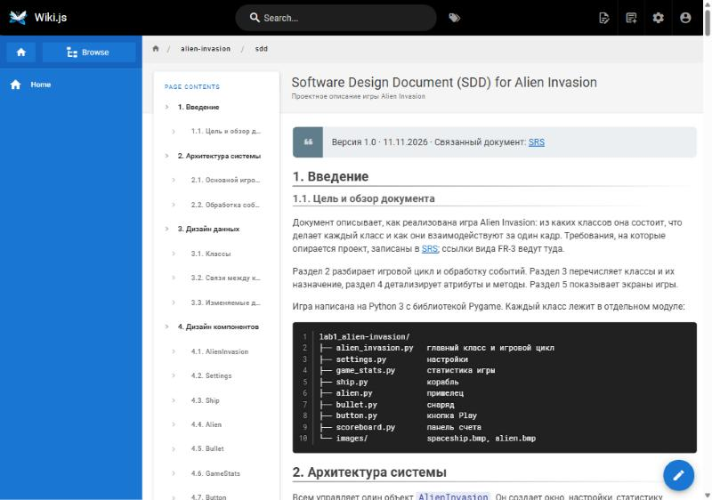

| Раздел | Содержание |
|---|---|
| 1. Введение | цель документа, структура проекта по файлам |
| 2. Архитектура системы | игровой цикл и обработка событий |
| 3. Дизайн данных | классы и их назначение, связи между ними, изменяемые данные |
| 4. Дизайн компонентов | атрибуты и методы каждого класса |
| 5. Дизайн интерфейса | игровой экран, стартовый экран, Game Over, переходы между ними |
| 6. История изменений | версии документа |

Схемы я рисовал в Mermaid прямо в тексте страницы: Wiki.js сам превращает такой блок в картинку, и схему потом можно поправить как обычный текст. В SDD их четыре: игровой цикл, обработка событий, связи классов и переходы между экранами.

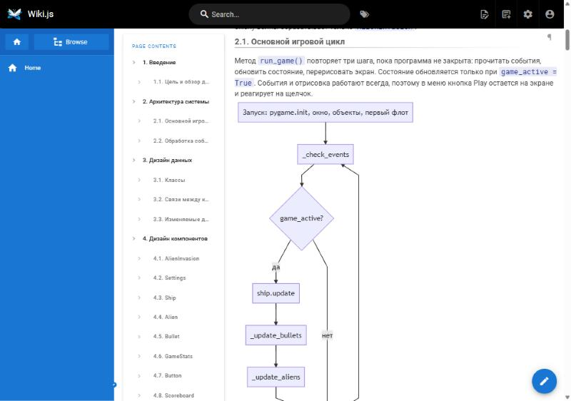

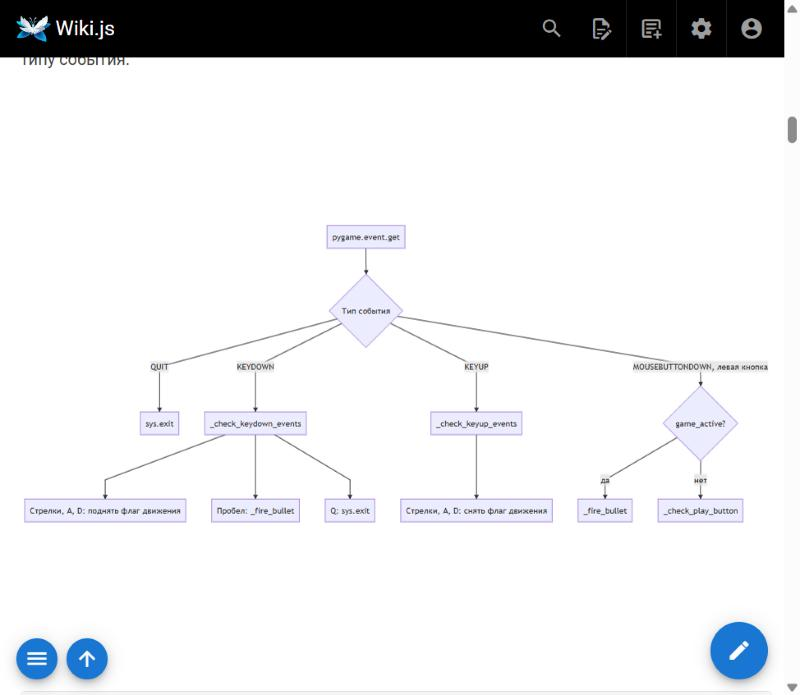

В задании перечислено семь классов, в игре их восемь. Восьмой - `Scoreboard`, он выводит счет, рекорд и уровень. На каждый класс в разделе 4 приходится по две таблицы, с атрибутами и с методами. Так выглядит `Ship`:

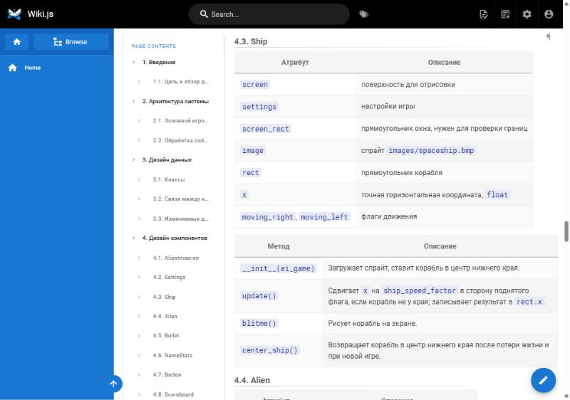

Экраны игры нарисованы псевдографикой в блоках кода. С экраном Game Over вышла заминка: в игре его нет, после проигрыша просто снова появляется кнопка Play. В разделе 5.2 я описал, как это работает сейчас, и рядом нарисовал, как должно быть после задачи #16.

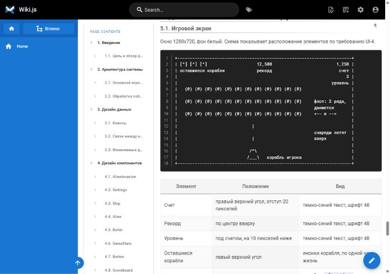

## Часть 2. Задачи в Redmine

Свежий Redmine пустой, в нем нет ни трекеров, ни статусов. Сначала я загрузил стандартную русскую конфигурацию, потом переименовал трекер "Улучшение" в "Фича", как сказано в задании, и создал проект "Alien Invasion Game".

Задачи я завел скриптом `WikiAlien/redmine-seed.rb`, который выполняется в консоли Redmine. Вбивать 18 задач через форму долго, а со скриптом их список хранится в репозитории и на другом компьютере восстанавливается двумя командами:

```bash
docker compose cp redmine-seed.rb redmine:/tmp/seed.rb
```

```bash
docker compose exec -T redmine sh -c 'SECRET_KEY_BASE=$REDMINE_SECRET_KEY_BASE RAILS_ENV=production bundle exec rails runner /tmp/seed.rb'
```

Задач получилось 18: 17 в трекере "Фича" и одна в трекере "Ошибка". Первые 11 повторяют список из задания, остальные семь я добавил по своему SRS. В описании каждой задачи написано, что сделать, к какому требованию она относится и как понять, что она готова.

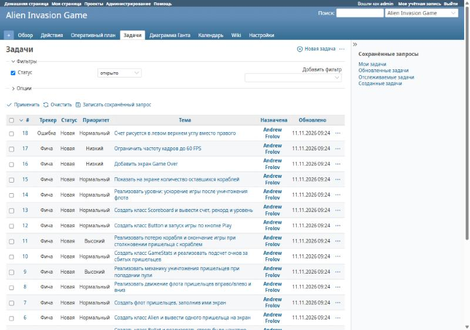

| № | Трекер | Тема | Требование | Версия |
|---|---|---|---|---|
| 1 | Фича | Создать главный класс игры AlienInvasion и окно Pygame | FR-10 | 1.0 |
| 2 | Фича | Создать класс Settings для хранения всех настроек | NFR-3 | 1.0 |
| 3 | Фича | Создать класс Ship и отобразить корабль на экране | FR-1 | 1.0 |
| 4 | Фича | Реализовать непрерывное движение корабля влево и вправо по нажатию клавиш | FR-1 | 1.0 |
| 5 | Фича | Создать класс Bullet и реализовать стрельбу по нажатию на пробел | FR-2 | 1.0 |
| 6 | Фича | Создать класс Alien и вывести одного пришельца на экран | FR-3 | 1.0 |
| 7 | Фича | Создать флот пришельцев, заполнив ими экран | FR-3 | 1.0 |
| 8 | Фича | Реализовать движение флота пришельцев вправо/влево и вниз | FR-3 | 1.0 |
| 9 | Фича | Реализовать механику уничтожения пришельцев при попадании пули | FR-4, FR-5 | 1.0 |
| 10 | Фича | Создать класс GameStats и реализовать подсчет очков за сбитых пришельцев | FR-4 | 1.0 |
| 11 | Фича | Реализовать потерю корабля и окончание игры при столкновении пришельца с кораблем | FR-6, FR-7 | 1.0 |
| 12 | Фича | Создать класс Button и запуск игры по кнопке Play | FR-9 | 1.1 |
| 13 | Фича | Создать класс Scoreboard и вывести счет, рекорд и уровень | FR-8 | 1.1 |
| 14 | Фича | Реализовать уровни: ускорение игры после уничтожения флота | FR-5 | 1.1 |
| 15 | Фича | Показать на экране количество оставшихся кораблей | FR-8 | 1.1 |
| 16 | Фича | Добавить экран Game Over | FR-7 | 1.1 |
| 17 | Фича | Ограничить частоту кадров до 60 FPS | NFR-1 | 1.1 |
| 18 | Ошибка | Счет рисуется в левом верхнем углу вместо правого | FR-8 | 1.1 |

У каждой задачи есть приоритет (7 высоких, 9 нормальных, 2 низких) и оценка времени от 1 до 3 часов. В сумме вышло 36 часов.

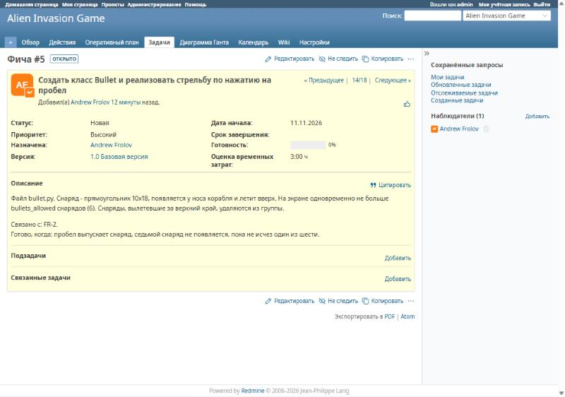

Задачи я разложил по двум версиям. В "1.0 Базовая версия" попали первые 11, без них игра не запустится. В "1.1 Интерфейс и доработки" остальные семь.

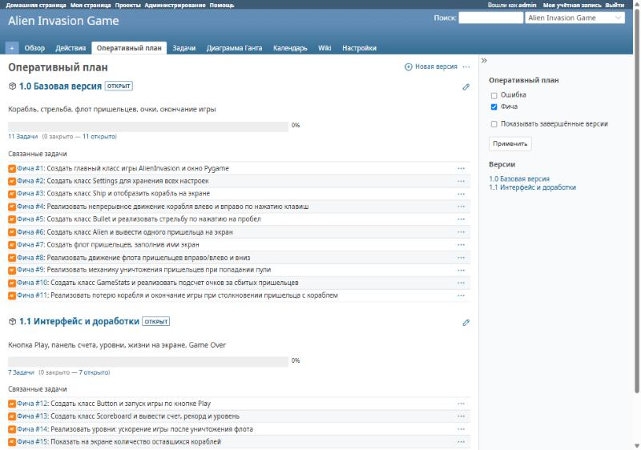

В команде я один, поэтому все 18 задач назначены на меня через поле "Назначена". Статус у всех "Новая", хотя большая часть уже сделана в игре: задание просит спланировать разработку, и закрывать задачи задним числом я не стал.

## Трудности

Дольше всего я возился с Docker. На ноутбуке его не было, а после установки Docker Desktop показал окно "WSL is unresponsive". Компоненты Windows для WSL оказались включены, но самого WSL в системе не было. Команда `wsl --install --no-distribution` падала с ошибкой `REGDB_E_CLASSNOTREG`. Помог только MSI-установщик WSL со страницы релизов Microsoft на GitHub: после него и перезагрузки Docker запустился.

Вторая проблема всплыла при первом запуске базы вики. Контейнер поднялся, но роли и базы `wiki_alien` в нем не было. В логах нашлась строка `/bin/sh^M: bad interpreter`: git на Windows сохранил скрипт `docker-init/01-create-wiki-role.sh` с переводами строк CRLF, и Linux внутри контейнера не смог его выполнить. Я перевел файл в LF, пересоздал том с базой и добавил `.gitattributes` со строкой `*.sh text eol=lf`, чтобы после следующего клонирования не наступить на это снова.

С Redmine была одна мелочь. Его консоль `rails runner` не запускалась через `docker compose exec` и требовала `secret_key_base`. При обычном старте эту переменную выставляет входной скрипт образа, а `exec` его обходит, так что я передаю ее в команде явно.

## Результаты

В Wiki.js заполнены страницы SRS и SDD. В SRS 10 функциональных требований, 4 нефункциональных и 5 требований к интерфейсу. В SDD описаны 8 классов и нарисованы 4 схемы. В Redmine есть проект "Alien Invasion Game" с 18 задачами, и каждое требование через таблицу трассировки в SRS связано со своими задачами.

Больше всего пользы оказалось от сверки требований с кодом. Пока игра была просто лабой, я не замечал, что счет стоит не в том углу и что жизни нигде не видны. Теперь на это есть задачи #15 - #18.

Файлы работы:

| Путь | Что там |
|---|---|
| `WikiAlien/compose.yaml` | запуск Wiki.js и Redmine |
| `WikiAlien/docs/` | тексты страниц вики в Markdown |
| `WikiAlien/redmine-seed.rb` | скрипт, который создает проект и задачи в Redmine |
| `WikiAlien/backups/wiki_alien_2026-11-11.dump` | дамп базы Wiki.js с заполненными страницами |
| `Lab4-Alien-Invasion-Docs/screenshots/` | скриншоты к отчету |
