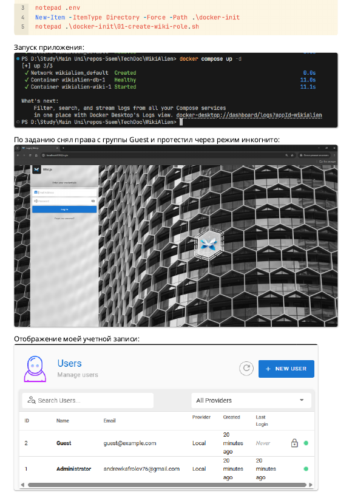
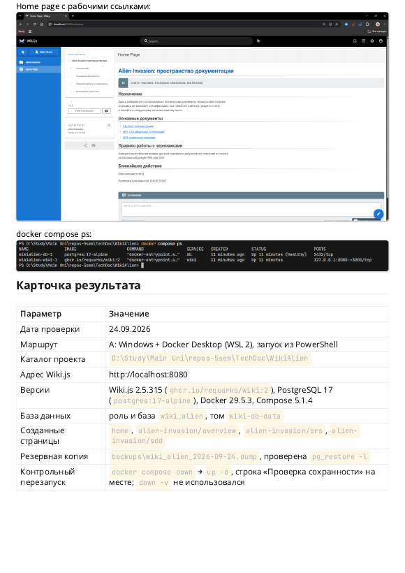

# Практическая работа 1. Wiki.js и Redmine в Docker

Локальный стенд для документации проекта Alien Invasion. Сначала здесь был только Wiki.js с PostgreSQL (практическая работа 1), потом для [лабораторной 4](../Lab4-Alien-Invasion-Docs/README.md) я добавил Redmine.

## Файлы

| Файл | Что это |
|---|---|
| `compose.yaml` | четыре сервиса: Wiki.js, его база, Redmine, его база |
| `.env` | пароли баз данных |
| `docker-init/01-create-wiki-role.sh` | создает роль и базу `wiki_alien` при первом запуске |
| `backups/` | дампы базы Wiki.js |
| `docs/` | тексты страниц вики в Markdown |
| `redmine-seed.rb` | создает в Redmine проект и задачи |
| `Отчет.pdf` | отчет по практической работе 1 со скриншотами |

## Сервисы

| Сервис | Образ | Адрес |
|---|---|---|
| Wiki.js | `ghcr.io/requarks/wiki:2` | `http://127.0.0.1:8080` |
| База Wiki.js | `postgres:17-alpine` | внутри сети Docker |
| Redmine | `redmine:6` | `http://127.0.0.1:3000` |
| База Redmine | `postgres:17-alpine` | внутри сети Docker |

Наружу открыты только два порта, и оба привязаны к `127.0.0.1`.

## Что сделано в практической работе 1

Поднял Wiki.js с PostgreSQL через Docker Compose. Wiki.js ходит в базу под отдельной ролью `wiki_alien` без прав суперпользователя, ее создает скрипт из `docker-init`. Снял права с группы Guest, чтобы без входа вики не открывалась. Создал четыре страницы: главную, паспорт документации и каркасы SRS и SDD. Сделал дамп базы и проверил, что страницы переживают `docker compose down` и `up -d`.

Подробности и остальные скриншоты лежат в `Отчет.pdf`.





## Запуск

```bash
docker compose up -d
```

На новом компьютере база вики пустая. Восстановить страницы из дампа:

```bash
docker compose cp backups/wiki_alien_2026-09-24.dump db:/tmp/wiki.dump
```

```bash
docker compose exec -T db pg_restore -U postgres -d wiki_alien --no-owner --role=wiki_alien /tmp/wiki.dump
```

Redmine после первого запуска тоже пустой. Проект и задачи создаются скриптом:

```bash
docker compose cp redmine-seed.rb redmine:/tmp/seed.rb
```

```bash
docker compose exec -T redmine sh -c 'SECRET_KEY_BASE=$REDMINE_SECRET_KEY_BASE RAILS_ENV=production bundle exec rails runner /tmp/seed.rb'
```

Для Redmine в `.env` должны быть заданы `REDMINE_DB_PASSWORD` и `REDMINE_SECRET_KEY_BASE`.
