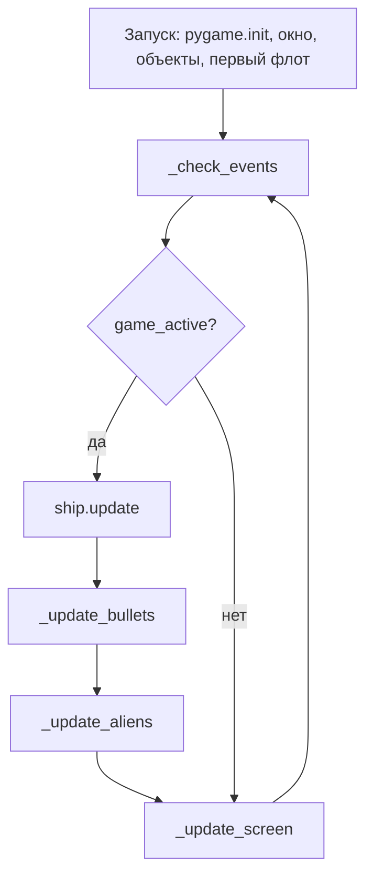
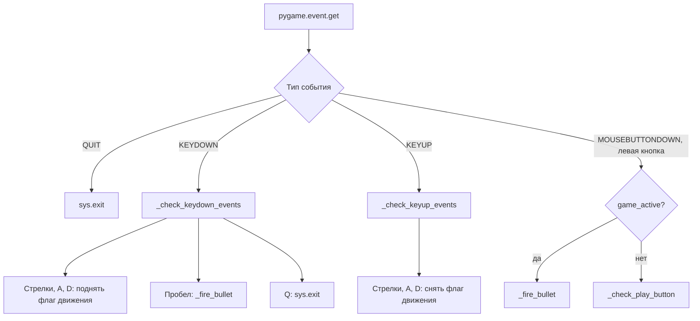
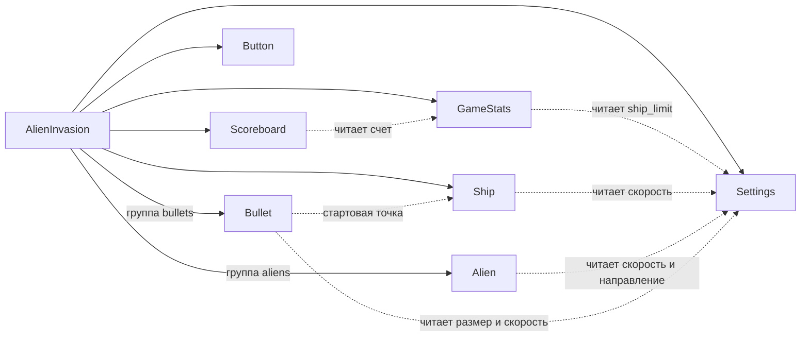
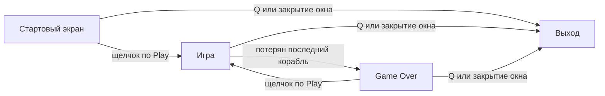

> Версия 1.0 · 11.11.2026 · Связанный документ: [SRS](/alien-invasion/srs)

## 1. Введение

### 1.1. Цель и обзор документа

Документ описывает, как реализована игра Alien Invasion: из каких классов она состоит, что делает каждый класс и как они взаимодействуют за один кадр. Требования, на которые опирается проект, записаны в [SRS](/alien-invasion/srs); ссылки вида FR-3 ведут туда.

Раздел 2 разбирает игровой цикл и обработку событий. Раздел 3 перечисляет классы и их назначение, раздел 4 детализирует атрибуты и методы. Раздел 5 показывает экраны игры.

Игра написана на Python 3 с библиотекой Pygame. Каждый класс лежит в отдельном модуле:

```
lab1_alien-invasion/
├── alien_invasion.py   главный класс и игровой цикл
├── settings.py         настройки
├── game_stats.py       статистика игры
├── ship.py             корабль
├── alien.py            пришелец
├── bullet.py           снаряд
├── button.py           кнопка Play
├── scoreboard.py       панель счета
└── images/             spaceship.bmp, alien.bmp
```

## 2. Архитектура системы

Всем управляет один объект `AlienInvasion`. Он создает окно, настройки, статистику, корабль и две группы спрайтов (снаряды и пришельцы), а потом крутит игровой цикл. Остальные классы получают в конструкторе ссылку на этот объект и берут из него экран и настройки. Друг о друге `Ship`, `Alien` и `Bullet` не знают: столкновения, разворот флота и смену волны обрабатывает только `AlienInvasion`.

### 2.1. Основной игровой цикл

Метод `run_game()` повторяет три шага, пока программа не закрыта: прочитать события, обновить состояние, перерисовать экран. Состояние обновляется только при `game_active = True`. События и отрисовка работают всегда, поэтому в меню кнопка Play остается на экране и реагирует на щелчок.



Что происходит внутри шагов обновления:

| Шаг | Действия |
|---|---|
| `ship.update()` | Сдвигает корабль по флагам движения, не выпуская за края окна (FR-1). |
| `_update_bullets()` | Двигает снаряды вверх, удаляет вылетевшие за верхний край, затем вызывает `_check_bullet_alien_collisions()`: попадания, очки, рекорд, при пустом флоте - новая волна и следующий уровень (FR-2, FR-4, FR-5). |
| `_update_aliens()` | Проверяет края и при необходимости разворачивает флот, двигает пришельцев, проверяет столкновение с кораблем и выход на нижнюю границу (FR-3, FR-6). |
| `_update_screen()` | Рисует кадр слоями: фон, корабль, снаряды, пришельцы, панель счета, в меню - кнопка Play. В конце вызывает `pygame.display.flip()`. |

Частота кадров сейчас не ограничена: в цикле нет `pygame.time.Clock`, и скорости заданы в пикселях за кадр. Ограничение до 60 FPS вынесено в задачу Redmine #17.

### 2.2. Обработка событий

`_check_events()` раз за кадр забирает очередь `pygame.event.get()` и разбирает ее по типу события.



| Событие | Условие | Реакция |
|---|---|---|
| `QUIT` | закрыто окно | выход из программы (FR-10) |
| `KEYDOWN` | стрелка вправо или D | `ship.moving_right = True` |
| `KEYDOWN` | стрелка влево или A | `ship.moving_left = True` |
| `KEYDOWN` | пробел | `_fire_bullet()` |
| `KEYDOWN` | Q | выход из программы |
| `KEYUP` | стрелки, A, D | соответствующий флаг сбрасывается в `False` |
| `MOUSEBUTTONDOWN` | левая кнопка, игра идет | `_fire_bullet()` |
| `MOUSEBUTTONDOWN` | левая кнопка, игра не идет | `_check_play_button(mouse_pos)` |

Нажатие клавиши не двигает корабль напрямую, оно только поднимает флаг. Сам сдвиг делает `Ship.update()` в каждом кадре, пока флаг поднят. За счет этого корабль едет непрерывно при удержании клавиши, а не шагает по одному нажатию.

## 3. Дизайн данных

### 3.1. Классы

| Класс | Модуль | Назначение |
|---|---|---|
| `AlienInvasion` | `alien_invasion.py` | Основной класс игры: создает ресурсы, ведет игровой цикл, обрабатывает события и столкновения. |
| `Settings` | `settings.py` | Хранит все настройки: размер окна, цвета, скорости, лимиты, коэффициенты усложнения. |
| `Ship` | `ship.py` | Корабль игрока: позиция, движение, отрисовка. |
| `Alien` | `alien.py` | Один пришелец флота. Наследует `pygame.sprite.Sprite`. |
| `Bullet` | `bullet.py` | Снаряд, выпущенный кораблем. Наследует `pygame.sprite.Sprite`. |
| `GameStats` | `game_stats.py` | Статистика текущей игры: счет, рекорд, уровень, оставшиеся корабли, признак активной игры. |
| `Button` | `button.py` | Прямоугольная кнопка с текстом. В игре одна, "Play". |
| `Scoreboard` | `scoreboard.py` | Выводит на экран счет, рекорд и уровень из `GameStats`. |

### 3.2. Связи между классами



Сплошная стрелка означает "создает и хранит", пунктирная - "читает данные".

### 3.3. Изменяемые данные

Настройки делятся на две части. Статические задаются один раз в `Settings.__init__()`. Динамические меняются по ходу игры и возвращаются к начальным значениям при перезапуске через `initialize_dynamic_settings()`.

| Параметр | Начальное значение | Когда меняется |
|---|---|---|
| `ship_speed_factor` | 1.5 | умножается на 1.1 после каждой волны |
| `bullet_speed_factor` | 4.0 | умножается на 1.1 после каждой волны |
| `alien_speed_factor` | 0.5 | умножается на 1.1 после каждой волны |
| `alien_points` | 50 | умножается на 1.5 после каждой волны, результат округляется вниз |
| `fleet_direction` | 1 (вправо) | меняет знак при касании края |

Статистика в `GameStats` меняется так:

| Поле | Начальное значение | Когда меняется | Сбрасывается при новой игре |
|---|---|---|---|
| `game_active` | `False` | `True` по кнопке Play, `False` после потери последнего корабля | - |
| `score` | 0 | растет на `alien_points` за каждого сбитого пришельца | да |
| `level` | 1 | растет на 1 после каждой волны | да |
| `ships_left` | 3 | уменьшается на 1 при потере корабля | да |
| `high_score` | 0 | обновляется, когда `score` его превысил | нет, живет до конца сеанса |

Координаты корабля, пришельцев и снарядов хранятся дважды: точное значение во `float`-атрибуте (`x` или `y`) и целое в `rect`. Скорости дробные, а `pygame.Rect` хранит только целые числа. Без отдельного `float` сдвиг на 0.5 пикселя за кадр терялся бы при округлении.

## 4. Дизайн компонентов

### 4.1. AlienInvasion

Атрибуты:

| Атрибут | Тип | Описание |
|---|---|---|
| `settings` | `Settings` | общий экземпляр настроек |
| `screen` | `pygame.Surface` | окно игры, поверхность для отрисовки |
| `stats` | `GameStats` | статистика игры |
| `sb` | `Scoreboard` | панель счета |
| `ship` | `Ship` | корабль игрока |
| `bullets` | `pygame.sprite.Group` | снаряды на экране |
| `aliens` | `pygame.sprite.Group` | флот пришельцев |
| `play_button` | `Button` | кнопка Play |

Методы:

| Метод | Описание |
|---|---|
| `__init__()` | Инициализирует Pygame, создает окно и все игровые объекты, строит первый флот. |
| `run_game()` | Основной цикл игры (раздел 2.1). |
| `_check_events()` | Разбирает очередь событий (раздел 2.2). |
| `_check_keydown_events(event)` | Нажатия клавиш: флаги движения, выстрел, выход. |
| `_check_keyup_events(event)` | Отпускание клавиш: сброс флагов движения. |
| `_check_play_button(mouse_pos)` | Если щелчок попал в кнопку и игра не идет, сбрасывает настройки и статистику, пересоздает флот, ставит корабль в центр, скрывает курсор. |
| `_fire_bullet()` | Создает снаряд, если на экране их меньше `bullets_allowed`. |
| `_create_fleet()` | Считает число пришельцев в ряду и число рядов (не больше трех), заполняет сетку. |
| `_create_alien(alien_number, row_number)` | Создает одного пришельца и ставит его в ячейку сетки. |
| `_update_bullets()` | Двигает снаряды, удаляет ушедшие за верхний край, проверяет попадания. |
| `_check_bullet_alien_collisions()` | `pygame.sprite.groupcollide()` удаляет столкнувшиеся снаряд и пришельца; начисляет очки, обновляет рекорд; при пустом флоте запускает новую волну и повышает уровень. |
| `_update_aliens()` | Разворот у края, движение флота, проверка столкновения с кораблем и нижней границей. |
| `_check_fleet_edges()` | Ищет пришельца, коснувшегося края; если такой есть, вызывает разворот. |
| `_change_fleet_direction()` | Опускает всех пришельцев на `fleet_drop_speed` и меняет знак `fleet_direction`. |
| `_check_aliens_bottom()` | Если пришелец достиг нижней границы, вызывает `_ship_hit()`. |
| `_ship_hit()` | Потеря корабля: минус жизнь, очистка поля, новый флот, корабль в центр, пауза 0.5 с. Если жизней нет, останавливает игру и показывает курсор. |
| `_update_screen()` | Рисует кадр и выводит его на экран. |

Сетка флота рассчитывается от размера спрайта пришельца. По горизонтали шаг равен двум ширинам спрайта, слева и справа остается отступ в одну ширину: `number_aliens_x = (screen_width - 2 * alien_width) // (2 * alien_width)`. По вертикали шаг равен 2.5 высоты спрайта, рядов не больше трех.

### 4.2. Settings

| Атрибут | Значение | Описание |
|---|---|---|
| `screen_width`, `screen_height` | 1280, 720 | размер окна |
| `bg_color` | (255, 255, 255) | цвет фона |
| `ship_limit` | 3 | число кораблей на игру |
| `bullet_width`, `bullet_height` | 10, 18 | размер снаряда |
| `bullet_color` | (255, 87, 34) | цвет снаряда |
| `bullets_allowed` | 6 | максимум снарядов на экране |
| `fleet_drop_speed` | 12 | на сколько пикселей флот опускается при развороте |
| `speedup_scale` | 1.1 | множитель скоростей на новом уровне |
| `score_scale` | 1.5 | множитель цены пришельца на новом уровне |

Динамические атрибуты перечислены в разделе 3.3.

| Метод | Описание |
|---|---|
| `__init__()` | Задает статические настройки и вызывает `initialize_dynamic_settings()`. |
| `initialize_dynamic_settings()` | Возвращает скорости, цену пришельца и направление флота к начальным значениям. |
| `increase_speed()` | Умножает скорости на `speedup_scale`, цену пришельца на `score_scale`. |

### 4.3. Ship

| Атрибут | Описание |
|---|---|
| `screen` | поверхность для отрисовки |
| `settings` | настройки игры |
| `screen_rect` | прямоугольник окна, нужен для проверки границ |
| `image` | спрайт `images/spaceship.bmp` |
| `rect` | прямоугольник корабля |
| `x` | точная горизонтальная координата, `float` |
| `moving_right`, `moving_left` | флаги движения |

| Метод | Описание |
|---|---|
| `__init__(ai_game)` | Загружает спрайт, ставит корабль в центр нижнего края. |
| `update()` | Сдвигает `x` на `ship_speed_factor` в сторону поднятого флага, если корабль не у края; записывает результат в `rect.x`. |
| `blitme()` | Рисует корабль на экране. |
| `center_ship()` | Возвращает корабль в центр нижнего края после потери жизни и при новой игре. |

### 4.4. Alien

| Атрибут | Описание |
|---|---|
| `screen`, `settings` | экран и настройки |
| `image` | спрайт `images/alien.bmp` |
| `rect` | прямоугольник пришельца |
| `x` | точная горизонтальная координата, `float` |

| Метод | Описание |
|---|---|
| `__init__(ai_game)` | Загружает спрайт, ставит пришельца у левого верхнего угла с отступом в его размер. |
| `update()` | Сдвигает `x` на `alien_speed_factor * fleet_direction`. |
| `check_edges()` | Возвращает `True`, если пришелец коснулся левого или правого края окна. |

Направление и скорость лежат в `Settings`, а не в каждом пришельце. Поэтому флот разворачивается сменой одного числа.

### 4.5. Bullet

| Атрибут | Описание |
|---|---|
| `screen`, `settings` | экран и настройки |
| `color` | цвет снаряда из настроек |
| `rect` | прямоугольник снаряда; создается в точке `ship.rect.midtop` |
| `y` | точная вертикальная координата, `float` |

| Метод | Описание |
|---|---|
| `__init__(ai_game)` | Создает прямоугольник снаряда у носа корабля. |
| `update()` | Уменьшает `y` на `bullet_speed_factor`, снаряд летит вверх. |
| `draw_bullet()` | Рисует снаряд через `pygame.draw.rect()`. |

У снаряда нет картинки, поэтому группа `bullets` не может нарисовать себя вызовом `draw()`. Снаряды рисуются по одному в `_update_screen()`.

### 4.6. GameStats

| Атрибут | Описание |
|---|---|
| `settings` | настройки игры, отсюда берется `ship_limit` |
| `game_active` | идет ли игра; при запуске программы `False` |
| `high_score` | рекорд сеанса |
| `ships_left` | сколько кораблей осталось |
| `score` | текущий счет |
| `level` | текущий уровень |

| Метод | Описание |
|---|---|
| `__init__(ai_game)` | Задает `game_active` и `high_score`, вызывает `reset_stats()`. |
| `reset_stats()` | Сбрасывает `ships_left`, `score` и `level` перед новой игрой. |

`high_score` задан в `__init__()`, а не в `reset_stats()`, поэтому рекорд не пропадает при перезапуске игры.

### 4.7. Button

| Атрибут | Описание |
|---|---|
| `screen`, `screen_rect` | экран и его прямоугольник |
| `width`, `height` | размер кнопки, 200 на 50 |
| `button_color` | цвет кнопки, (25, 25, 90) |
| `text_color` | цвет текста, (255, 255, 255) |
| `font` | системный шрифт, размер 48 |
| `rect` | прямоугольник кнопки по центру экрана |
| `msg_image`, `msg_image_rect` | готовое изображение надписи и его положение |

| Метод | Описание |
|---|---|
| `__init__(ai_game, msg)` | Создает прямоугольник кнопки и один раз готовит надпись. |
| `_prep_msg(msg)` | Превращает текст в изображение и центрирует его в кнопке. |
| `draw_button()` | Заливает прямоугольник цветом кнопки и выводит надпись. |

Сама кнопка щелчки не обрабатывает. Попадание проверяет `AlienInvasion._check_play_button()` через `rect.collidepoint()`.

### 4.8. Scoreboard

| Атрибут | Описание |
|---|---|
| `screen`, `screen_rect` | экран и его прямоугольник |
| `settings`, `stats` | настройки и статистика, откуда берутся значения |
| `text_color` | цвет текста, (25, 25, 90) |
| `font` | системный шрифт, размер 48 |
| `score_image`, `score_rect` | изображение счета и его место (справа вверху) |
| `high_score_image`, `high_score_rect` | изображение рекорда (по центру вверху) |
| `level_image`, `level_rect` | изображение уровня (под счетом) |

| Метод | Описание |
|---|---|
| `__init__(ai_game)` | Запоминает экран, настройки и статистику, готовит три изображения. |
| `prep_score()` | Округляет счет до десятков, форматирует с разделителем тысяч, готовит изображение. |
| `prep_high_score()` | То же для рекорда. |
| `prep_level()` | Готовит изображение номера уровня. |
| `check_high_score()` | Если счет превысил рекорд, обновляет рекорд и его изображение. |
| `show_score()` | Выводит три готовых изображения на экран. |

Текст превращается в изображение только при изменении значения, а не в каждом кадре: `show_score()` лишь копирует готовые поверхности.

## 5. Дизайн пользовательского интерфейса

### 5.1. Игровой экран

Окно 1280x720, фон белый. Схема показывает расположение элементов по требованию UI-4.

```
+----------------------------------------------------------------------+
| [^] [^] [^]                    12,500                          1,250 |
| оставшиеся корабли             рекорд                           счет |
|                                                                    3 |
|                                                              уровень |
|   (@) (@) (@) (@) (@) (@) (@) (@) (@) (@) (@) (@)                    |
|                                                                      |
|   (@) (@) (@) (@) (@) (@) (@) (@) (@) (@) (@) (@)     флот: 3 ряда,  |
|                                                       движется       |
|   (@) (@) (@) (@) (@) (@) (@) (@) (@) (@) (@) (@)     <-- и -->      |
|                                                                      |
|                              |                                       |
|                                                       снаряды летят  |
|                              |                        вверх          |
|                                                                      |
|                             /^\                                      |
|                            /___\   корабль игрока                    |
+----------------------------------------------------------------------+
```

| Элемент | Положение | Вид |
|---|---|---|
| Счет | правый верхний угол, отступ 20 пикселей | темно-синий текст, шрифт 48 |
| Рекорд | по центру вверху | темно-синий текст, шрифт 48 |
| Уровень | под счетом, на 10 пикселей ниже | темно-синий текст, шрифт 48 |
| Оставшиеся корабли | левый верхний угол | иконки корабля, по одной на жизнь |
| Флот | верхняя часть экрана | спрайты `alien.bmp`, до трех рядов |
| Снаряды | между кораблем и флотом | оранжевые прямоугольники 10x18 |
| Корабль | центр нижнего края | спрайт `spaceship.bmp` |

В текущей версии иконки кораблей не выводятся (задача Redmine #15), а счет из-за ошибки оказывается в левом верхнем углу (#18).

### 5.2. Стартовый экран и экран окончания игры

Стартовый экран появляется сразу после запуска. Игровое поле уже нарисовано: корабль внизу, флот наверху, счет 0, рекорд 0, уровень 1. Все объекты неподвижны. В центре экрана поверх поля расположена темно-синяя кнопка с белой надписью "Play", курсор мыши виден. Щелчок по кнопке запускает игру и скрывает курсор. Клавиши движения и пробел до старта ничего не делают, работает только Q.

```
+----------------------------------------------------------------------+
|                                  0                                 0 |
|                                                                    1 |
|   (@) (@) (@) (@) (@) (@) (@) (@) (@) (@) (@) (@)                    |
|   (@) (@) (@) (@) (@) (@) (@) (@) (@) (@) (@) (@)                    |
|   (@) (@) (@) (@) (@) (@) (@) (@) (@) (@) (@) (@)                    |
|                                                                      |
|                          +--------------+                            |
|                          |     Play     |                            |
|                          +--------------+                            |
|                                                                      |
|                             /^\                                      |
|                            /___\                                     |
+----------------------------------------------------------------------+
```

Экран окончания игры появляется, когда потерян последний корабль. Сейчас он устроен так же, как стартовый: поле застывает в том состоянии, в котором закончилась игра, появляются курсор и кнопка Play. На панели остаются итоговый счет, рекорд и достигнутый уровень. Щелчок по Play начинает новую игру с нуля, рекорд при этом сохраняется.

Отличить такой экран от стартового можно только по ненулевому счету. Поэтому запланирована доработка (задача Redmine #16): над кнопкой выводится надпись "Game Over" и строка с итоговым счетом.

```
+----------------------------------------------------------------------+
|                               12,500                           8,400 |
|                                                                    4 |
|                                                                      |
|                             Game Over                                |
|                          Ваш счет: 8,400                             |
|                                                                      |
|                          +--------------+                            |
|                          |     Play     |                            |
|                          +--------------+                            |
|                                                                      |
+----------------------------------------------------------------------+
```

Переходы между экранами:



## 6. История изменений

| Версия | Дата | Изменение |
|---|---|---|
| 0.1 | 24.09.2026 | Создан каркас SDD. |
| 1.0 | 11.11.2026 | Описаны игровой цикл, обработка событий, классы и экраны игры. |
